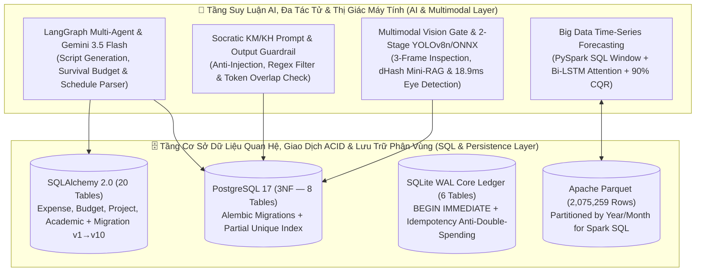

# Xin chào, mình là Phan Quốc Bảo (Kizakawa) 👋
### AI & LLM Systems Engineer • Computer Vision & Big Data ML • Backend & Database (SQL) Developer
**Sinh viên ngành Khoa học máy tính (Computer Science)**

*Chuyên sâu thiết kế và triển khai các hệ thống Trí tuệ nhân tạo thực chiến (Multi-Agent LLM, RAG, Multimodal Vision, Deep Learning & ONNX Runtime) kết hợp nền tảng Backend hiệu năng cao (FastAPI) và Cơ sở dữ liệu chuẩn hóa (PostgreSQL, SQL Server, SQLite WAL, PySpark SQL).*

[🎯 Giới thiệu](#-giới-thiệu-tổng-quan--định-hướng-nghề-nghiệp) •
[🧠 Năng lực Cốt lõi (AI / Backend / SQL / BA)](#-năng-lực-cốt-lõi-core-engineering-competencies) •
[🚀 7 Dự án Trọng điểm](#-hệ-sinh-thái-7-dự-án-trọng-điểm-featured-repositories) •
[🏗️ Kiến trúc AI & CSDL SQL](#-điểm-nhấn-kiến-trúc-ai-pipeline--thiết-kế-csdl-sql) •
[🛠️ Công nghệ](#-công-nghệ--công-cụ-sử-dụng-technical-stack)

---

## 🎯 Giới Thiệu Tổng Quan & Định Hướng Nghề Nghiệp

Mình là **Phan Quốc Bảo**, sinh viên ngành **Khoa học máy tính (Computer Science)** với định hướng trọng tâm là **Kỹ sư Trí tuệ Nhân tạo (AI / LLM & Computer Vision Engineer)** kiêm **Phát triển Sản phẩm Phần mềm & Cơ sở dữ liệu (Backend / Full-Stack / SQL)**.

Điểm mạnh cốt lõi của mình là khả năng **đưa các mô hình AI/LLM và Học sâu vào phần mềm vận hành thực tế (Production-Grade AI Software)** thay vì chỉ dừng ở mức thử nghiệm Notebook:
1. **Kỹ thuật Hệ thống LLM, Multi-Agent & RAG:** Thiết kế luồng tác tử tự phục hồi với **LangGraph**, kiểm duyệt đầu ra bằng **Output Guardrails** chống lộ đáp án và chống Prompt Injection, xây dựng cơ chế chống trùng lặp ngữ nghĩa/thị giác (**Perceptual `dHash` Mini-RAG**) và khung đánh giá thực nghiệm định lượng (**Rubric & Benchmark `M1–M5`**).
2. **Thị giác Máy tính (Computer Vision), Học sâu & Dữ liệu lớn (Big Data ML):** Xây dựng kiến trúc phát hiện 2 tầng thời gian thực (**MediaPipe + YOLOv8n `99.5% mAP50`**), tối ưu hóa suy luận trên CPU bằng **ONNX Runtime (`18.9ms/ảnh`)**, kiểm duyệt đa phương thức **3-Frame Multimodal Gemini Vision**, và huấn luyện mạng **PyTorch `Bi-LSTM + Temporal Attention` / `LightGBM` / `Spark MLlib` / `CQR 90%`** trên tập dữ liệu lớn **2,07 triệu bản ghi**.
3. **Nền tảng CSDL Quan hệ (SQL), Phân tích Nghiệp vụ (BA) & Đóng gói Triển khai:** Thiết kế lược đồ CSDL chuẩn hóa `3NF` (từ 8 đến 20 bảng trên **PostgreSQL / SQLite WAL / SQL Server**), đảm bảo giao dịch nguyên tử **ACID**, truy vấn phân tích bằng **SQL / PySpark Window Functions**, và đóng gói triển khai thực tế qua **Docker Compose** hoặc **Bộ cài đặt Windows Portable (`1-Click Setup` kèm Auto-Backup Migration `v1 → v10`)**.

---

## 🧠 Năng Lực Cốt Lõi (Core Engineering Competencies)

| Lĩnh Vực Chuyên Môn | Kỹ Năng Kỹ Thuật & Minh Chứng Thực Tế Trong Các Dự Án |
| :--- | :--- |
| **🤖 AI, LLM Agents & Multimodal Engineering** *(Định hướng trọng tâm — AI Engineer)* | • **Multi-Agent Orchestration (`LangGraph`):** Thiết kế đồ thị trạng thái đa tác tử tự động hóa quy trình từ phân tích chủ đề, sinh kịch bản theo hợp đồng `Pydantic v2`, chấm điểm phản biện đa vòng (`ScriptCritic`) đến tổng hợp đa phương thức (`AI-YouTube-Studio`). • **LLM Guardrails, Prompt Engineering & Evaluation:** Thiết kế Prompt sư phạm 2 cấp độ (`KM` & `KH`) có rào chắn chống Prompt Injection, bộ lọc **Output Guardrail** (Regex + Token Overlap) tự động sinh lại khi vi phạm, và bộ công cụ đánh giá **Benchmark `M1–M5`** (`do-an-chuyen-nganh`). • **Perceptual Mini-RAG & Context Engineering:** Xây dựng `VideoMemoryRAG` đối chiếu chữ ký thị giác `dHash` 3 khung hình chống lặp cảnh, và tích hợp **Google Gemini 3.5 Flash Context Agent** hỗ trợ lập kế hoạch/tóm tắt học tập (`personal-life-app`). • **Hạ tầng AI Chịu lỗi (`KeyRotator` & Multi-Adapter):** Thiết kế `LLMServiceInterface` chuyển đổi linh hoạt giữa *OpenAI/Groq/Gemini REST API*, *Qwen2.5-Coder-7B trên Colab GPU* và *Offline Mock*; tự động xoay vòng khóa API khi chạm hạn mức `HTTP 429`. |
| **👁️ Computer Vision, Deep Learning & Big Data ML** *(CV & Data Science Engineer)* | • **Real-Time Object Detection & Edge Optimization:** Thiết kế pipeline 2 tầng **MediaPipe FaceMesh + YOLOv8n** đạt **99.5% mAP50**, xuất mô hình sang **ONNX Runtime** giúp suy luận đạt `18.9ms/ảnh` ngay trên CPU (`drowsy-driver-detection-yolov8`). • **Multimodal Vision QA & Programmatic Video/Audio:** Kết hợp **OpenCV** (đo độ nét Laplacian, kiểm tra chuyển động) với **Gemini Vision** duyệt 3 khung hình đầu–giữa–cuối và dựng hình **FFmpeg GPU (`h264_nvenc` / `h264_qsv`)** chuẩn âm thanh `EBU R128 (-14 LUFS)`. • **Time-Series Deep Learning & Uncertainty Quantification:** Huấn luyện **PyTorch `Bi-LSTM + Attention`**, `LightGBM`, `XGBoost`, `Spark MLlib` kết hợp **Conformalized Quantile Regression (`90% CQR`)** và đối soát phân cấp (`smart-hems-bigdata-forecasting`). |
| **🗄️ Thiết Kế CSDL Quan Hệ & Lập Trình SQL** *(Database & Big Data SQL)* | • **Thiết kế Lược đồ Quan hệ (ERD & Chuẩn hóa 3NF):** Thiết kế CSDL **20 bảng** (`personal-life-app`), **8 bảng PostgreSQL** (`do-an-chuyen-nganh`), **Sổ cái 6 bảng** (`tcb-digital-banking-mobile`) và **5 bảng** (`hsk-cosmic-academy`). • **Truy vấn SQL & PySpark Window Functions:** Thành thạo `JOIN`, `GROUP BY`, `HAVING`, `CTE`, `Window Functions (LAG, AVG/STDDEV OVER)` trên cả CSDL giao dịch và tập dữ liệu lớn **2.075.259 bản ghi Parquet**. • **Giao dịch ACID, Concurrency & Schema Migrations:** Xử lý khóa giao dịch tức thời `BEGIN IMMEDIATE TRANSACTION`, `idempotency_key`, `Partial Unique Index`, chuỗi **Alembic (`0001 → 0003`)** và **Auto-Backup Migration Engine (`v1 → v10`)**. |
| **💻 Phát Triển Sản Phẩm, BA & Triển Khai** *(Product Dev, BA & Implementation)* | • **Full-Stack & Microservices:** Phát triển Backend với **Python (`FastAPI`, `SQLAlchemy 2.0`)**, **Node.js (`Express`, `node:sqlite`)** cùng giao diện **React 19, Vite 8, Zustand**, **Streamlit** và **Android Native (Java)**. • **Phân tích Nghiệp vụ (BA) & Đóng gói Triển khai:** Đặc tả Use Cases (`UC01–UC06`), kiểm soát giao dịch hạn mức (`Quota/Cooldown`), đóng gói **Docker Compose** và bộ cài **Windows Portable (`.zip`)** bảo toàn 100% dữ liệu người dùng tại `%APPDATA%` kèm **179 bài kiểm thử tự động `pytest`**. |

---

## 🚀 Hệ Sinh Thái 7 Dự Án Trọng Điểm (Featured Repositories)

> *Tất cả 7 dự án dưới đây đều được trình bày đồng bộ, có đầy đủ tài liệu Kiến trúc AI/Hệ thống, Thiết kế CSDL (SQL), Phân tích Nghiệp vụ và Hướng dẫn Triển khai chi tiết.*

### A. Nhóm Kỹ Thuật Hệ Thống AI, LLM Agents, Computer Vision & Dữ Liệu Lớn (AI & Data Engineering)

| Dự Án & Lĩnh Vực AI | Điểm Nhấn Kiến Trúc AI / ML • CSDL (SQL) • Kiểm Chứng Thực Nghiệm | Công Nghệ Cốt Lõi |
| :--- | :--- | :--- |
| 🎬 **[AI-YouTube-Studio](https://github.com/Kizakawa/AI-YouTube-Studio)** *(Hệ thống Multi-Agent LLM, Multimodal Vision & Tự động hóa Đa kênh)* | • **Đồ thị Đa tác tử Tự phục hồi (`LangGraph` — 242 Python Modules):** Điều phối khép kín từ săn chủ đề, sinh kịch bản chuẩn `Pydantic`, phản biện đa vòng (`ScriptCritic`) đến tổng hợp giọng nói đa tầng và dựng video GPU. • **Kiểm định Thị giác 3 Khung hình & `dHash Mini-RAG`:** Kết hợp **Gemini Multimodal Vision** + **OpenCV** và kho băm thị giác `VideoMemoryRAG` loại bỏ 100% cảnh dính watermark hoặc trùng lặp. • **Hạ tầng Bền vững & 179 Kiểm thử `pytest`:** Tầng **SQLAlchemy ORM** tự động chuyển đổi dự phòng `PostgreSQL` $\leftrightarrow$ `SQLite WAL`, xoay vòng khóa `KeyRotator` và cách ly hạn ngạch 7 cụm OAuth cho 9 kênh. | `Python 3.11+` `LangGraph` `Gemini Vision` `dHash Mini-RAG` `FastAPI & SQL` `FFmpeg GPU` `179 Pytest` |
| 🧠 **[do-an-chuyen-nganh](https://github.com/Kizakawa/do-an-chuyen-nganh)** *(Hệ thống Chấm Code Tự động & Gia sư LLM Sư phạm có Guardrail)* | • **Module Phản hồi Sư phạm LLM 2 Cấp độ (`KM` & `KH`):** Đóng khung ngữ cảnh lỗi `<student_code>` và `<execution_evidence>` chống Prompt Injection; hỗ trợ đa mô hình qua Adapter (`OpenAI/Groq/Gemini API` & `Qwen2.5-Coder-7B` trên Colab T4). • **Output Guardrail & Giao dịch Hạn mức (`HintOrchestrationService`):** Tự động lọc mã lộ đáp án (Regex + `Token Overlap`), sinh lại tối đa 2 lần; quản lý quota 3 lượt/bài, cooldown 120s, lỗi AI tuyệt đối không trừ lượt. • **CSDL PostgreSQL 8 Bảng (3NF) & Benchmark `M1–M5`:** Vận hành với **Judge0 Sandbox**, `Partial Unique Index`, **Alembic Migrations (`0001 → 0003`)**, **Docker Compose** và xuất báo cáo đánh giá thực nghiệm CSV/JSONL. | `LLM Guardrails` `Qwen2.5-Coder` `FastAPI` `Judge0 Sandbox` `PostgreSQL 17` `Alembic` `Docker Compose` |
| ⚡ **[smart-hems-bigdata-forecasting](https://github.com/Kizakawa/smart-hems-bigdata-forecasting)** *(Phân tích Dữ liệu Lớn 2,07 Triệu Dòng & Dự báo Phụ tải bằng Học sâu)* | • **Pipeline PySpark SQL & Window Functions (2.075.259 bản ghi):** Lưu trữ phân vùng **Apache Parquet**, nội suy có giới hạn và trích xuất đặc trưng trễ/trượt (`LAG`, `AVG OVER`, `STDDEV OVER`) đảm bảo **Zero Data Leakage**. • **Hệ mô hình Học sâu & Định lượng Bất định (`CQR 90%`):** Kết hợp **PyTorch `Bi-LSTM + Temporal Attention`**, `LightGBM`, `XGBoost`, `Spark MLlib` cùng đối soát phân cấp (`Hierarchical Reconciliation`). • **Ứng dụng BI & Cảnh báo Quá tải (`app.py`):** Bảng điều khiển **Streamlit** trực quan hóa dải dự báo, cảnh báo vượt ngưỡng công suất `P95` và dự toán chi phí điện năng (`kWh`). | `Apache Spark 4.0` `PySpark SQL` `PyTorch Bi-LSTM` `LightGBM / XGB` `CQR 90%` `Apache Parquet` `Streamlit App` |
| 👁️ **[drowsy-driver-detection-yolov8](https://github.com/Kizakawa/drowsy-driver-detection-yolov8)** *(Hệ thống Thị giác Máy tính 2 Tầng Phát hiện Tài xế Buồn ngủ Real-Time)* | • **Kiến trúc Thị giác 2 Tầng (`99.5% mAP50`):** Tầng 1 định vị 468 điểm mốc khuôn mặt và cắt chuẩn hóa vùng mắt bằng **MediaPipe FaceMesh**; Tầng 2 phân loại trạng thái mắt bằng **YOLOv8n** kết hợp bộ đếm thời gian cảnh báo. • **Tối ưu hóa Suy luận CPU bằng ONNX Runtime (`18.9ms/ảnh`):** Chuyển đổi trọng số PyTorch sang `.onnx` tăng tốc 30% trên CPU, đi kèm công cụ kiểm định phân phối dữ liệu (`check_imbalance.py`) và giao diện Web **Streamlit (`scripts/app.py`)**. | `YOLOv8n` `MediaPipe` `ONNX Runtime` `OpenCV` `PyTorch` `Streamlit` |

### B. Nhóm Phần Mềm Quản Trị Tích Hợp AI, Tài Chính & Cơ Sở Dữ Liệu Quan Hệ (Full-Stack & FinTech)

| Dự Án & Phân Hệ Nghiệp Vụ | Điểm Nhấn Thiết Kế CSDL (SQL) • Tích Hợp AI • Nghiệp Vụ & Triển Khai | Công Nghệ Cốt Lõi |
| :--- | :--- | :--- |
| 📊 **[personal-life-app](https://github.com/Kizakawa/personal-life-app)** *(Phần mềm Quản trị Cá nhân, Ngân sách, Dự án & Trợ lý AI — Bản V16)* | • **Tích hợp Trợ lý AI Ngữ cảnh (`Google Gemini 3.5 Flash`):** Tự động phân tích dữ liệu học tập/chi tiêu, tối ưu hóa **Kế hoạch Ngân sách Sinh tồn**, tóm tắt sổ ghi bài và bóc tách lịch trình thông minh (`ai_schedule_parser.py`). • **CSDL Quan hệ 20 Bảng (`SQLAlchemy 2.0`) & 24 API Routers:** Quản lý đồng bộ *Giao dịch Thu-Chi, Định mức Ngân sách, Dự án, Công việc, Học vụ, Sổ ghi bài & Sự kiện Âm/Dương lịch*. • **Auto-Backup Migration (`v1 → v10`) & Windows Portable:** Tự động sao lưu CSDL trước khi nâng cấp và đóng gói bộ cài `.zip` tách biệt dữ liệu tại `%APPDATA%`. | `Gemini 3.5 Flash` `FastAPI` `SQLAlchemy 2.0` `SQL (20 Tables)` `React 19 + Vite` `Windows Portable` |
| 🏦 **[tcb-digital-banking-mobile](https://github.com/Kizakawa/tcb-digital-banking-mobile)** *(Hệ thống Ngân hàng Số, Sổ cái Giao dịch ACID & Bảo mật OWASP)* | • **Sổ cái CSDL Giao dịch ACID (`SQLite WAL` — 6 Bảng):** Khóa giao dịch tức thời `BEGIN IMMEDIATE TRANSACTION`, kiểm tra số dư nguyên tử trong câu lệnh `UPDATE` và khóa chống gửi trùng `idempotencyKey` (Zero Double-Spending). • **Bảo mật Phần cứng & Kiểm thử Tự động (9/9 E2E Tests):** Mã hóa thông tin nhạy cảm bằng **AndroidKeyStore (`AES-256-GCM`)**, xác thực OTP hằng thời gian, đối soát thu/chi ròng theo tháng và tích hợp CI/CD. | `SQL (ACID Ledger)` `Node.js / Express` `Java (Android)` `AES-256-GCM` `OWASP Top 10` `GitHub Actions` |
| 🛸 **[hsk-cosmic-academy](https://github.com/Kizakawa/hsk-cosmic-academy)** *(Nền tảng Học thuật Thông minh: Chấm nét Chữ Hán, Nhận diện Giọng nói & SM-2)* | • **Chấm điểm Tương tác Đa phương thức:** Chấm nét viết chữ Hán trên lưới Ô Chữ Điền bằng thuật toán **Pixel-Mask IoU Overlap**, chấm phát âm bằng **Web Speech Recognition (`zh-CN`)** và lập lịch ôn tập ngắt quãng **Anki SM-2**. • **CSDL SQLite WAL 5 Bảng & Backend Zero-Dependency:** Quản lý **6 bộ giáo trình, 42 bài học, 930 từ vựng chuẩn hóa**, đồng bộ đám mây và thống kê tiến độ 7 ngày trên nền Node.js Core (`< 50ms` cold start). | `Anki SM-2` `Speech & IoU AI` `SQL (node:sqlite)` `Node.js Core` `HTML5 Canvas` `Docker / PWA` |

---

## 🏗️ Điểm Nhấn Kiến Trúc: AI Pipeline & Thiết Kế CSDL (SQL)

Sự kết hợp giữa **Tầng Suy luận AI/LLM có Kiểm duyệt (Guardrails & Vision Gate)** và **Tầng Cơ sở Dữ liệu Quan hệ Toàn vẹn (ACID & Normalized SQL Schema)** trong các dự án:

---

## 🛠️ Công Nghệ & Công Cụ Sử Dụng (Technical Stack)

### 🤖 AI, LLM Agents, Computer Vision & Deep Learning

### 🗄️ Cơ Sở Dữ Liệu Quan Hệ, Truy Vấn SQL & Dữ Liệu Lớn (Big Data)

### ⚙️ Backend, Frontend, Đóng Gói Triển Khai & Kiểm Thử (DevOps & QA)

---

## 📫 Liên Hệ Tuyển Dụng & Hợp Tác

- 👤 **Họ và tên:** **Phan Quốc Bảo** (Nickname: **Kizakawa**)
- 🎓 **Chuyên ngành:** Khoa học máy tính (Computer Science)
- 📧 **Email:** [phanquocbao.vp@gmail.com](mailto:phanquocbao.vp@gmail.com)
- 💼 **GitHub Portfolio:** [https://github.com/Kizakawa](https://github.com/Kizakawa)
- 🎯 **Vị trí ứng tuyển:** **AI Engineer (LLM Systems / Multi-Agent / Computer Vision / Data & ML)** • **Backend & Product Software Engineer (Python / FastAPI / SQL)**
