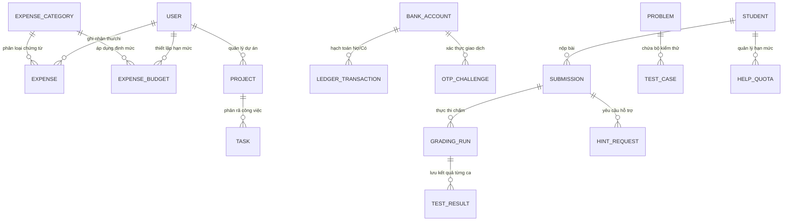

# Xin chào, mình là Phan Quốc Bảo (Kizakawa) 👋
### Sinh Viên Ngành Khoa Học Máy Tính (Computer Science)
**Phát Triển Sản Phẩm Phần Mềm (Product Dev) • Phân Tích Nghiệp Vụ (BA) • Triển Khai Hệ Thống & CSDL SQL**

*Tập trung xây dựng phần mềm quản trị & nghiệp vụ có cấu trúc CSDL quan hệ chuẩn hóa (3NF), đảm bảo toàn vẹn giao dịch ACID, truy vấn phân tích dữ liệu lớn (SQL / Window Functions), đặc tả quy trình nghiệp vụ chặt chẽ và đóng gói triển khai thực tế trên Windows / Docker.*

[🎯 Giới thiệu](#-giới-thiệu-tổng-quan--định-hướng-nghề-nghiệp) •
[💼 Ma trận Năng lực (Dev / BA / Triển khai)](#-năng-lực-cốt-lõi-theo-vị-trí-ứng-tuyển-core-competencies) •
[🚀 7 Dự án Trọng điểm](#-hệ-sinh-thái-7-dự-án-trọng-điểm-featured-repositories) •
[🗄️ Điểm nhấn CSDL & SQL](#-điểm-nhấn-thiết-kế-csdl-quan-hệ--lập-trình-sql-trong-dự-án) •
[🛠️ Công nghệ](#-công-nghệ--công-cụ-sử-dụng-technical-stack)

---

## 🎯 Giới Thiệu Tổng Quan & Định Hướng Nghề Nghiệp

Mình là **Phan Quốc Bảo**, sinh viên ngành **Khoa học máy tính (Computer Science)**, có nền tảng vững chắc về **Thiết kế Cơ sở dữ liệu Quan hệ & Lập trình SQL**, kết hợp tư duy **Phân tích Nghiệp vụ (Business Analysis)** và kỹ năng **Phát triển – Đóng gói – Triển khai Phần mềm** đầu-cuối (End-to-End).

Trong mọi dự án thực tế và đồ án chuyên ngành, mình luôn tiếp cận bài toán theo đúng quy trình chuẩn của một **hệ thống phần mềm quản trị doanh nghiệp (ERP / FinTech / EdTech / BI Analytics)**:
1. **Phân tích Nghiệp vụ & Đặc tả Yêu cầu (BA):** Khảo sát bài toán thực tế, mô hình hóa Use Cases, thiết kế **Sơ đồ Thực thể Liên kết (ERD)** và định nghĩa các **Quy tắc Nghiệp vụ (Business Rules)** như: quản lý thu-chi, kiểm soát hạn mức ngân sách theo danh mục, hạch toán sổ cái tài chính, đối soát giao dịch, tính toán chi phí bậc thang và quản lý định mức sử dụng.
2. **Thiết kế CSDL Quan hệ & Lập trình Truy vấn SQL:** Chuẩn hóa lược đồ CSDL (`3NF` từ 8 đến 20 bảng), thiết lập khóa ngoại (`Foreign Keys`), chỉ mục tối ưu (`Composite & Partial Unique Indexes`), kiểm soát giao dịch đồng thời (**ACID Transactions**, chống Race Condition / Chi tiêu kép) và xây dựng truy vấn tổng hợp/cửa sổ trượt (`GROUP BY`, `Window Functions LAG / AVG OVER`) trên cả CSDL giao dịch (**PostgreSQL / SQLite WAL / SQL Server**) lẫn dữ liệu lớn (**2,07 triệu bản ghi với PySpark SQL**).
3. **Phát triển Sản phẩm, Triển khai & Bảo trì:** Phát triển kiến trúc phân tầng rõ ràng (`Presentation – Business Logic – Data Access`), viết bộ kiểm thử tự động và đóng gói bộ cài đặt độc lập trên **Windows (`Portable Windows Build`)** / **Docker Compose**, kèm cơ chế **tự động sao lưu & nâng cấp CSDL (`Database Migration & Auto-Backup v1 → v10`)** giúp bảo toàn 100% dữ liệu khách hàng khi nâng cấp qua 16 phiên bản (`V1 → V16`).

---

## 💼 Năng Lực Cốt Lõi Theo Vị Trí Ứng Tuyển (Core Competencies)

| Nhóm Năng Lực / Vị Trí | Kỹ Năng Chuyên Môn & Minh Chứng Thực Tế Trong Các Dự Án |
| :--- | :--- |
| **🗄️ Lập Trình CSDL & SQL** *(Nền tảng cốt lõi)* | • **Thiết kế Lược đồ Quan hệ (ERD & Chuẩn hóa 3NF):** Thiết kế CSDL **20 bảng** (`personal-life-app`), **8 bảng** (`do-an-chuyen-nganh`), **Sổ cái 6 bảng** (`tcb-digital-banking-mobile`) và **5 bảng** (`hsk-cosmic-academy`). • **Truy vấn SQL & Báo cáo Đa chiều:** Thành thạo `JOIN`, `GROUP BY`, `HAVING`, `Subqueries`, `CTE`, `Window Functions (LAG, AVG/STDDEV OVER)`, truy vấn đối soát thu-chi ròng theo kỳ, thống kê hạn mức ngân sách và xử lý **2.075.259 bản ghi** (`smart-hems-bigdata-forecasting`). • **Toàn vẹn Giao dịch (ACID & Concurrency):** Xử lý giao dịch nguyên tử (`BEGIN IMMEDIATE TRANSACTION`), kiểm tra điều kiện số dư trực tiếp trong mệnh đề `UPDATE ... WHERE balance >= amount`, sử dụng `idempotency_key` và `Partial Unique Index` chống ghi trùng dữ liệu khi có nhiều kết nối đồng thời. • **Quản lý Phiên bản CSDL (Migrations):** Vận hành chuỗi migration **Alembic (`0001 → 0003`)** trên PostgreSQL và tự xây dựng **Engine Migration (`v1 → v10`)** tự động kiểm tra phiên bản, tạo bản sao lưu trước khi chạy lệnh `ALTER TABLE`. |
| **💻 Phát Triển Sản Phẩm** *(Product Developer)* | • **Kiến trúc Phân hệ (Modular Architecture):** Thiết kế phần mềm chia theo từng phân hệ nghiệp vụ độc lập (*Quản lý Thu-Chi & Ngân sách, Quản lý Dự án & Công việc, Quản lý Học vụ & Điểm danh, Hạch toán Sổ cái Ngân hàng, Báo cáo BI Dashboard*). • **Backend & ORM/SQL:** Phát triển dịch vụ với **Python (`FastAPI`, `SQLAlchemy 2.0`, `PySpark`)**, **Node.js (`Express`, `node:sqlite`)** và **Java (`Android Native`)**. • **Frontend & Giao diện Người dùng:** Xây dựng giao diện thao tác dữ liệu trực quan, biểu mẫu nhập liệu có kiểm tra ràng buộc (Validation) với **React 19, Vite 8, Zustand**, **Streamlit** và **HTML5/CSS3/JS**. • **Kiểm thử Chất lượng (Automated QA):** Xây dựng **179 bài kiểm thử `pytest`** (`AI-YouTube-Studio`), bộ test tích hợp PostgreSQL (`do-an-chuyen-nganh`) và **9 kịch bản kiểm thử bảo mật & giao dịch đồng thời** (`tcb-digital-banking-mobile`). |
| **📋 Phân Tích Nghiệp Vụ** *(Business Analyst - BA)* | • **Đặc tả Yêu cầu & Use Cases:** Phân tích và tài liệu hóa đầy đủ luồng nghiệp vụ (`UC01–UC06` trong `do-an-chuyen-nganh`, nhật ký cải tiến nghiệp vụ qua 16 phiên bản `V1 → V16` trong `personal-life-app`). • **Thiết kế Quy tắc Nghiệp vụ (Business Rules):**   ◦ *Nghiệp vụ Tài chính – Ngân sách:* Phân loại chứng từ thu/chi theo danh mục, thiết lập định mức ngân sách tháng, hoạch định ngân sách tối ưu và cảnh báo vượt hạn mức.   ◦ *Nghiệp vụ Thanh toán & Sổ cái:* Xác thực 2 lớp (OTP), kiểm tra trạng thái tài khoản, hạch toán nợ/có đồng thời và lưu vết kiểm toán (`Audit Trail`).   ◦ *Nghiệp vụ Quản lý Định mức & Báo cáo:* Quản lý hạn mức sử dụng (`Quota/Cooldown`), dự toán chi phí điện năng (`kWh`) và cảnh báo vượt ngưỡng công suất. |
| **🚀 Triển Khai & Bảo Hành** *(Software Implementation)* | • **Đóng gói Bộ cài đặt Windows (`1-Click Portable`):** Xây dựng script đóng gói tự động (`build_portable_windows.bat`, `start_game.bat`, `setup.bat`) giúp khách hàng/người dùng cuối khởi chạy phần mềm ngay trên Windows. • **Bảo toàn Dữ liệu Khách hàng khi Nâng cấp:** Tách biệt hoàn toàn thư mục lưu trữ CSDL, khóa khôi phục (`Recovery Key`), file đính kèm và bản sao lưu của người dùng (`%APPDATA%\PersonalLifeApp`) khỏi thư mục mã nguồn chương trình — giúp cập nhật phần mềm qua 16 phiên bản (`V1 → V16`) không làm mất dữ liệu cũ. • **Triển khai Đa môi trường & Hỗ trợ Vận hành:** Triển khai hệ thống đa dịch vụ bằng **Docker Compose (`db`, `api`, `worker`, `test`)**, ghi log vận hành chi tiết phục vụ tra cứu và bảo hành. |

---

## 🚀 Hệ Sinh Thái 7 Dự Án Trọng Điểm (Featured Repositories)

> *Tất cả 7 dự án dưới đây đều được trình bày đồng bộ, có đầy đủ tài liệu Kiến trúc hệ thống, Thiết kế CSDL (SQL), Phân tích Nghiệp vụ và Hướng dẫn Triển khai chi tiết.*

### A. Nhóm Phần Mềm Quản Trị Nghiệp Vụ, Tài Chính & Cơ Sở Dữ Liệu Quan Hệ (ERP / FinTech / EdTech)

| Dự Án & Phân Hệ Nghiệp Vụ | Điểm Nhấn Thiết Kế CSDL (SQL) • Nghiệp Vụ (BA) • Triển Khai | Công Nghệ Cốt Lõi |
| :--- | :--- | :--- |
| 📊 **[personal-life-app](https://github.com/Kizakawa/personal-life-app)** *(Phần mềm Quản trị Tài chính, Ngân sách, Dự án & Học vụ — Bản V16)* | • **CSDL Quan hệ 20 Bảng (`SQLAlchemy 2.0`):** Quản lý đồng bộ các phân hệ *Giao dịch Thu-Chi (`expense`), Định mức Ngân sách (`expense_budget`), Danh mục (`expense_category`), Dự án (`project`), Công việc (`task`), Học vụ (`subject`, `grade_item`, `attendance_record`), Sổ ghi bài & Sự kiện Âm/Dương lịch* qua **24 REST API Routers**. • **Engine Nâng cấp CSDL Tự động (`migrations.py` v1 $\rightarrow$ v10):** Tự động tạo bản sao lưu (`before-upgrade backup`) và cấp mã khôi phục (`Recovery Key`) trước khi nâng cấp cấu trúc bảng. • **Triển khai Windows Portable:** Tách biệt dữ liệu người dùng tại `%APPDATA%`, hỗ trợ sao lưu/phục hồi (`backup.py`) và nâng cấp qua 16 phiên bản (`V1 → V16`) không mất dữ liệu. | `SQL / SQLite` `SQLAlchemy 2.0` `FastAPI` `React 19` `Zustand` `Windows Portable` |
| 🏦 **[tcb-digital-banking-mobile](https://github.com/Kizakawa/tcb-digital-banking-mobile)** *(Hệ thống Ngân hàng Số & Sổ cái Giao dịch Tài chính)* | • **Sổ cái CSDL Giao dịch ACID (`SQLite WAL`):** Thiết kế lược đồ 6 bảng chuẩn hóa quản lý *Tài khoản, Giao dịch chuyển khoản, Thanh toán hóa đơn, Hồ sơ định danh eKYC* và *Phiên xác thực OTP*. • **Chống Chi tiêu kép (Anti-Double-Spending):** Kết hợp khóa giao dịch tức thời `BEGIN IMMEDIATE TRANSACTION`, kiểm tra số dư nguyên tử trong câu lệnh `UPDATE` và khóa chống gửi trùng `idempotencyKey`. • **Báo cáo & Đối soát Sổ cái:** API truy vấn lịch sử giao dịch phân trang, lọc theo loại chứng từ và tổng hợp thu/chi ròng theo tháng kèm **9/9 kịch bản kiểm thử E2E**. | `SQL (ACID Ledger)` `Node.js / Express` `Java (Android)` `AES-256-GCM` `OWASP Security` `GitHub Actions CI` |
| 🧠 **[do-an-chuyen-nganh](https://github.com/Kizakawa/do-an-chuyen-nganh)** *(Hệ thống Chấm bài Tập Lập trình & Quản lý Hạn mức Tự động)* | • **CSDL PostgreSQL 8 Bảng Chuẩn hóa (3NF):** Quản lý toàn bộ vòng đời nghiệp vụ qua 8 bảng (`student`, `problem`, `test_case`, `submission`, `grading_run`, `test_result`, `help_quota`, `hint_request`) với chuỗi migration **Alembic (`0001 → 0003`)**. • **Kiểm soát Đồng thời & Quy tắc Nghiệp vụ (`UC01–UC06`):** Áp dụng `Partial Unique Index` ngăn chặn gửi yêu cầu trùng lặp; quản lý giao dịch hạn mức (3 lượt/bài, cooldown 120s, không trừ lượt khi lỗi hệ thống). • **Triển khai Container hóa:** Đóng gói 4 dịch vụ (`db`, `api`, `worker`, `test`) bằng **Docker Compose** kèm công cụ xuất báo cáo đánh giá định lượng CSV/JSONL. | `PostgreSQL 17` `Alembic Migrations` `SQLAlchemy` `FastAPI` `Judge0 Sandbox` `Docker Compose` |
| 🛸 **[hsk-cosmic-academy](https://github.com/Kizakawa/hsk-cosmic-academy)** *(Hệ thống Quản lý Học vụ, Luyện tập Đa kỹ năng & Đồng bộ Đám mây)* | • **CSDL Quan hệ & Đồng bộ Hai chiều (`SQLite WAL`):** Thiết kế 5 bảng cốt lõi (`users`, `sessions`, `user_state`, `leaderboard`, `community_decks`) quản lý **6 bộ giáo trình, 42 bài học và 930 mục từ vựng chuẩn hóa**. • **Thuật toán Nghiệp vụ Định kỳ (`Anki SM-2`) & Báo cáo Analytics:** Tính toán lịch ôn tập ngắt quãng theo 4 kỹ năng (*Đọc, Viết, Nghe, Phát âm*) và tổng hợp biểu đồ tiến độ 7 ngày. • **Kiến trúc Backend Zero-Dependency:** Vận hành 100% trên Node.js Core (`node:sqlite`, `node:http`), khởi động `< 50ms`, đóng gói sẵn `start_game.bat` và `Dockerfile`. | `SQL (node:sqlite)` `Node.js Core` `RESTful API` `Anki SM-2` `HTML5 Canvas` `Docker / PWA` |

### B. Nhóm Phân Tích Dữ Liệu Lớn (Big Data SQL), Tự Động Hóa & Khoa Học Máy Tính

| Dự Án & Phân Hệ Nghiệp Vụ | Điểm Nhấn Kỹ Thuật Dữ Liệu • Nghiệp Vụ (BA) • Triển Khai | Công Nghệ Cốt Lõi |
| :--- | :--- | :--- |
| ⚡ **[smart-hems-bigdata-forecasting](https://github.com/Kizakawa/smart-hems-bigdata-forecasting)** *(Phân tích Dữ liệu Lớn 2,07 Triệu Bản Ghi & Dự báo Phụ tải Điện năng)* | • **Truy vấn PySpark SQL & Window Functions trên 2.075.259 bản ghi:** Chuyển đổi dữ liệu sang định dạng cột **Apache Parquet** phân vùng theo `year/month`, sử dụng `LAG`, `AVG OVER`, `STDDEV OVER` và kiểm tra cân bằng công suất vật lý không rò rỉ dữ liệu (`Zero Data Leakage`). • **Đối soát Phân cấp & Báo cáo Chi phí (`app.py`):** Kết hợp `Spark MLlib`, `LightGBM/XGBoost`, `PyTorch Bi-LSTM` và khoảng tin cậy `90% CQR` trên **Streamlit Dashboard** để dự toán chi phí điện năng (`kWh`) và cảnh báo quá tải. | `Apache Spark 4.0` `PySpark SQL / Window` `Apache Parquet` `Spark MLlib / GBDT` `PyTorch Bi-LSTM` `Streamlit BI App` |
| 🎬 **[AI-YouTube-Studio](https://github.com/Kizakawa/AI-YouTube-Studio)** *(Nền tảng Tự động hóa Sản xuất & Quản trị Vận hành Đa kênh)* | • **Quy mô Hệ thống Thực tế:** Gồm **242 module Python** và **179 bài kiểm thử tự động (`pytest`)**, quản trị vận hành đồng thời **9 kênh nội dung**. • **Quản trị Dữ liệu & Chuyển đổi Dự phòng (`Failover`):** Tầng truy xuất dữ liệu **SQLAlchemy ORM** hỗ trợ tự động chuyển đổi giữa **PostgreSQL** và **SQLite WAL**, lưu trữ lịch sử sản xuất, chỉ số phân tích (Analytics) và kiểm soát trùng lặp nội dung. • **Điều phối Quy trình Tự phục hồi:** Quản lý hạn ngạch đa tài khoản (7 cụm OAuth) và tự động hóa kiểm định chất lượng đầu ra. | `Python 3.11+` `SQLAlchemy ORM` `PostgreSQL / SQLite` `FastAPI` `LangGraph` `Pytest (179 Tests)` |
| 👁️ **[drowsy-driver-detection-yolov8](https://github.com/Kizakawa/drowsy-driver-detection-yolov8)** *(Hệ thống Phát hiện & Cảnh báo Tài xế Buồn ngủ Thời gian thực)* | • **Kiến trúc Thị giác Máy tính 2 Tầng (`99.5% mAP50`):** Tầng 1 định vị và cắt vùng mắt bằng **MediaPipe FaceMesh**; Tầng 2 phân loại trạng thái đóng/mở mắt bằng **YOLOv8n** kết hợp bộ đếm quy tắc cảnh báo thời gian thực. • **Tối ưu hóa Suy luận CPU bằng ONNX Runtime (`18.9ms/ảnh`):** Chuyển đổi mô hình sang chuẩn `.onnx`, kèm công cụ kiểm định phân phối dữ liệu (`check_imbalance.py`) và giao diện giám sát **Streamlit (`scripts/app.py`)**. | `YOLOv8n` `MediaPipe` `ONNX Runtime` `OpenCV` `Streamlit` `Data QA Reports` |

---

## 🗄️ Điểm Nhấn Thiết Kế CSDL Quan Hệ & Lập Trình SQL Trong Dự Án

Để minh họa trực quan năng lực **Thiết kế CSDL & Phân tích Nghiệp vụ**, dưới đây là cấu trúc lược đồ CSDL thực tế đã được triển khai trong các dự án tiêu biểu:

### Các Kỹ Thuật CSDL & Nghiệp Vụ Trọng Tâm Đã Áp Dụng:
1. **Kiểm soát Giao dịch Tài chính Nguyên tử (ACID & Anti-Double-Spending):**
   - Trong [`tcb-digital-banking-mobile`](https://github.com/Kizakawa/tcb-digital-banking-mobile), mọi nghiệp vụ chuyển khoản và thanh toán hóa đơn đều được thực thi trong khối giao dịch khóa ghi tức thời (`BEGIN IMMEDIATE TRANSACTION`), kết hợp kiểm tra điều kiện số dư trực tiếp trong câu lệnh cập nhật (`UPDATE users SET balance = balance - ? WHERE id = ? AND balance >= ?`) và đối chiếu khóa `idempotency_key` để đảm bảo **không bao giờ xảy ra âm quỹ hoặc trừ tiền hai lần**.
2. **Thiết kế Phân hệ Ngân sách & Tự động Sao lưu khi Nâng cấp Phiên bản (Schema Migration `v1 → v10`):**
   - Trong [`personal-life-app`](https://github.com/Kizakawa/personal-life-app) (Bản V16), hệ thống gồm **20 bảng quan hệ** quản lý từ danh mục chi tiêu, hạn mức ngân sách theo kỳ, chế độ tối ưu ngân sách sinh tồn, tiến độ dự án đến bảng điểm học vụ và lịch sự kiện Âm/Dương. Đặc biệt, module `migrations.py` tự động đọc phiên bản CSDL (`app_metadata.database_version = 10`), **tự động tạo bản sao lưu dự phòng (`before-upgrade-vX-to-v10`)** trước khi thực thi các bước nâng cấp bảng, giúp quá trình triển khai bản mới cho người dùng cuối hoàn toàn an toàn.
3. **Ràng buộc Toàn vẹn & Chống Xung đột Đồng thời bằng Partial Unique Index:**
   - Trong [`do-an-chuyen-nganh`](https://github.com/Kizakawa/do-an-chuyen-nganh), lược đồ **PostgreSQL 8 bảng** sử dụng **Alembic Migrations (`0001 → 0003`)** và thiết lập `Partial Unique Index` trên trạng thái xử lý để chặn triệt để tình trạng một sinh viên bấm gửi nhiều yêu cầu đồng thời nhằm vượt hạn mức (`Quota = 3 lượt/bài`).
4. **Truy vấn Phân tích Cửa sổ Trượt (SQL Window Functions) trên Dữ liệu Lớn 2,07 Triệu Dòng:**
   - Trong [`smart-hems-bigdata-forecasting`](https://github.com/Kizakawa/smart-hems-bigdata-forecasting), toàn bộ quá trình làm sạch, nội suy có giới hạn và tạo biến trễ/thống kê trượt đều được thực thi bằng **PySpark SQL & Window Functions** trên dữ liệu phân vùng **Parquet**, đảm bảo hiệu năng cao và không rò rỉ dữ liệu.

---

## 🛠️ Công Nghệ & Công Cụ Sử Dụng (Technical Stack)

### 🗄️ Cơ Sở Dữ Liệu Quan Hệ, Truy Vấn SQL & Xử Lý Dữ Liệu Lớn

### 📋 Phân Tích Nghiệp Vụ, Phát Triển Backend & Frontend

### 🚀 Đóng Gói Triển Khai, Kiểm Thử & Tự Động Hóa (Deployment & QA)

---

## 📫 Liên Hệ Tuyển Dụng & Hợp Tác

- 👤 **Họ và tên:** **Phan Quốc Bảo** (Nickname: **Kizakawa**)
- 🎓 **Chuyên ngành:** Khoa học máy tính (Computer Science)
- 📧 **Email:** [vivyngocnghech@gmail.com](mailto:vivyngocnghech@gmail.com)
- 💼 **GitHub Portfolio:** [https://github.com/Kizakawa](https://github.com/Kizakawa)
- 🎯 **Vị trí ứng tuyển:** Nhân viên Phát triển Sản phẩm (Product Developer) • Nhân viên Phân tích Nghiệp vụ (BA) • Nhân viên Triển khai Phần mềm (Software Implementation)
